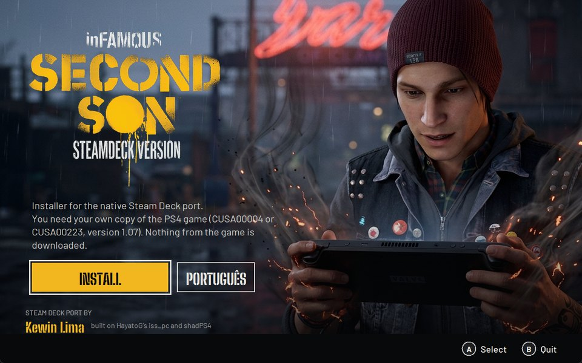
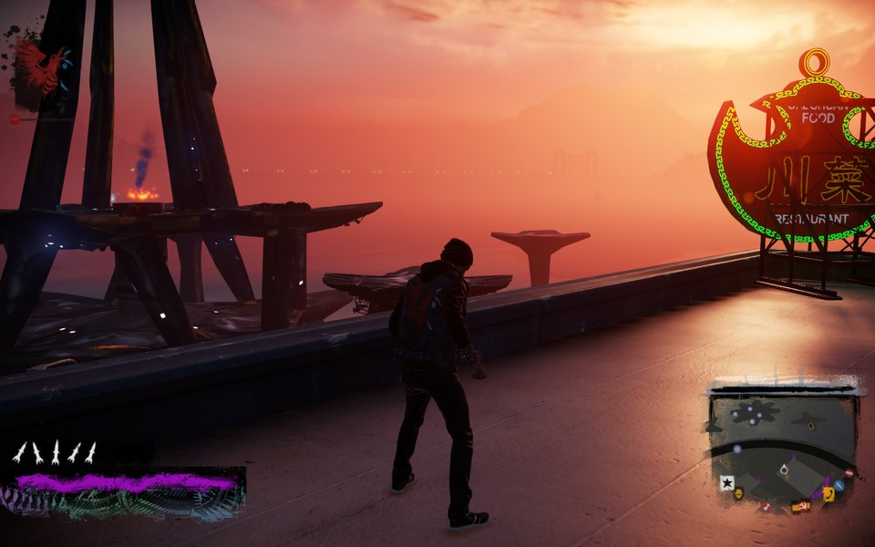
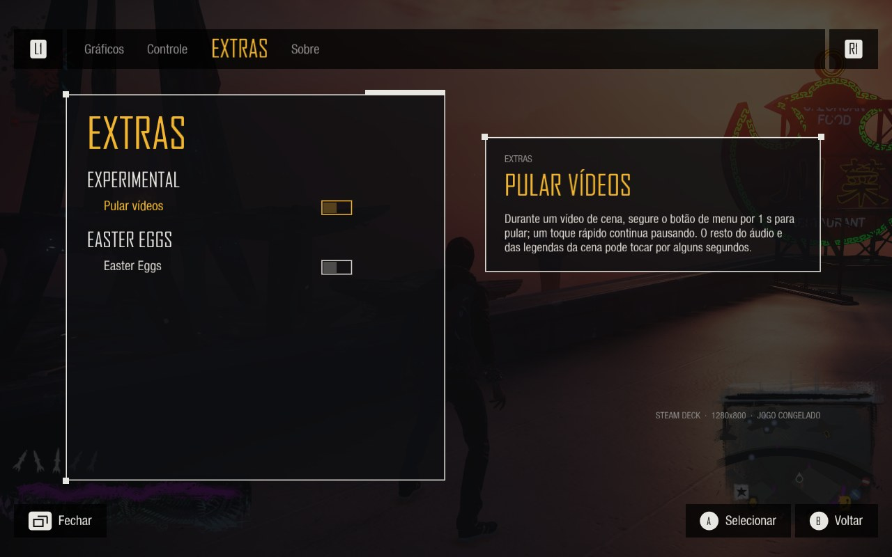
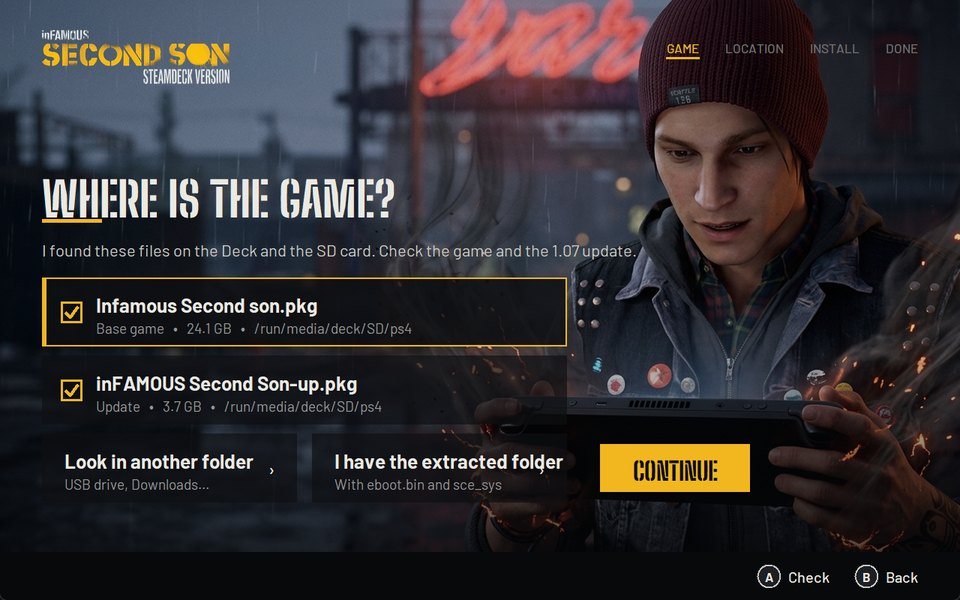
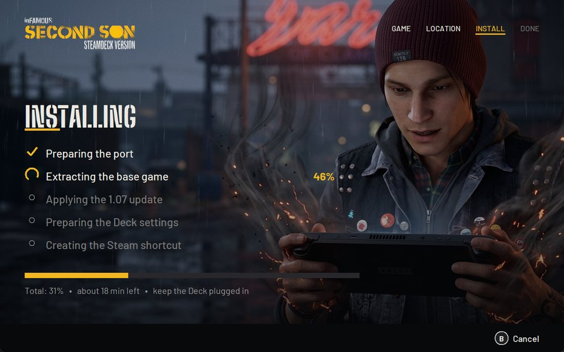

<p align="center"></p>

<p align="center"><a href="README.pt-BR.md">Português</a> • <b>English</b></p>

# inFAMOUS Second Son: Steamdeck Version

A native port of inFAMOUS Second Son (PS4) for the Steam Deck, with no emulator. It runs on HayatoG's
[iss_pc](https://github.com/HayatoG/iss_pc) (a PC recompilation of the game, with renderer v2), plus the Deck work
described below: performance, memory, controls, screens and an installer that needs no keyboard or mouse.

**You need your own copy of the game.** This repository has no game files and nothing from the game is downloaded:
the installer only uses the `.pkg` files you already have.

<p align="center"></p>

## What is in this version

- The whole game playable from start to finish: completed on the Deck on the good karma path; the evil karma path is
  being played right now.
- Renderer v2 with memory tuned for the Deck's 16 GB: the game uses about 3.5 GB of RAM instead of 6, and the
  heaviest tested section (the neon race) went from 33 to 41 FPS on average.
- Native 16:10 resolution of the Deck's screen, with videos cropped to 16:10.
- The Deck's gyro in the graffiti minigame, the Steam button pauses the game (like the PS button), port menu on the
  View button.
- Save and loading screens in the game's style, Deck A/B button glyphs.
- Shader cache: each shader is compiled only once and kept.
- Skip videos (experimental, off by default) and Easter Eggs (off by default): in the port menu, Extras tab.
- Automatic updates: before starting the game, the shortcut checks for a new version and updates by itself. Saves,
  shaders and settings are never deleted.

<p align="center"></p>

## Made for the Steam Deck

Everything that changed from the PS4 game to make it feel like a Steam Deck game.

### Spray minigame with the Deck

On the PS4, graffiti is done by turning the controller on its side and shaking it, with the motion sensor. On the
Deck it works with the Deck's gyro, and the game's instructions were redrawn with the Steam Deck instead of the PS4
controller: Delsin shaking the Deck and the hands turning the Deck on its side.

<p align="center">


</p>
<p align="center"></p>

Without the gyro (or if you prefer), the port menu has a guide to do the graffiti with the sticks.

### Controls screen with the Deck

In the game's Options, the drawing of the PS4 controller became the Steam Deck, with the back buttons (L4, L5, R4,
R5) and what each one does.

| PS4 | Steam Deck |
|---|---|
|  |  |

### Deck buttons in the game

The game's button icons (hints, menus, tutorials) replaced with the Deck's: A, B, X, Y, MENU and PAD (the trackpads)
instead of cross, circle, square, triangle, Options and touchpad, in the same style as the original icons and with
the game's own font.

<p align="center"></p>

The installer generates these icons on the Deck itself, from your game's files, in all 15 languages (about 20
seconds; nothing from the game ships in the package). The generator is plain Python with no dependencies:
[deck/botoes_deck.py](deck/botoes_deck.py).

### Startup screen

While the shaders are prepared, a screen in the game's style, with the art of Delsin with the Steam Deck, the
Steamdeck Version logo painted like spray, the progress bar and the time left.

<p align="center"></p>

### Skip videos (experimental)

Turned on in Extras in the port menu: during a video, holding the menu button for 1 s skips the scene (a quick tap
still pauses). The screen stays covered with the Delsin art until the game is back, and the scene's audio is muted.

<p align="center">


</p>

### Easter Eggs

Off by default. Turn it on in Extras in the port menu and keep an eye on the walls you paint. We will not say
more: it is a surprise.

<p align="center"></p>

### And more

- **Gyro:** Steam turns off the Deck controller's gyro and hands the game a virtual controller; the port reads the
  Deck's controller directly and turns the gyro on by itself.
- **Trackpads:** the left and right ones become the two halves of the PS4 touchpad (a firm press is a click).
- **Steam button:** freezes the game while the Steam menu or the quick access menu is open, like the PS button.
- **Port menu on the View button**, with graphics, performance, controls and Extras tabs, in the game's style.
- **Save and load screens** redone in the game's style, with the Deck's A and B letters.
- **16:10:** the Deck's screen resolution (1280x800) and videos cropped to 16:10.
- **Steam library art:** cover, banner, background, logo and icon of the Steamdeck Version.

## Requirements

- Steam Deck (tested on SteamOS 3.8).
- Your game's `.pkg` files: the base game (24 GB) and the 1.07 update (3.9 GB).
  - **CUSA00004** (Europe): the version tested on the Deck from start to finish.
  - **CUSA00223** (US): the main version of the original port; the 1.07 executable is the same.
- 32 GB free on the SSD or the microSD card, besides the space taken by the `.pkg` files.
- Internet only to download the port (about 110 MB).

## Installing (no keyboard, no mouse)

1. Copy the `.pkg` files to the Deck: to the **Downloads** folder or to the **microSD card** (any folder). From a PC
   you can use a USB drive, the SD card or Warpinator.
2. On the Deck, hold the power button and choose **Switch to Desktop** (Desktop Mode).
3. Open the browser, go to the [releases](https://github.com/KewinBR/infamous-second-son-steamdeck/releases/latest)
   page and download the file **`Instalar-inFAMOUS.desktop`**.
4. In the Downloads folder, tap it twice (if the system asks, choose **Continue/Execute**).
5. The installer opens full screen. Use touch or the controller (D-pad, **A** confirms, **B** goes back):
   1. **Where is the game:** it finds the `.pkg` files by itself and checks the game and the update.
   2. **Where to install:** SSD (faster loading) or microSD card.
   3. **Installing:** extracts the game and applies 1.07 (about 20 minutes; keep the Deck plugged in).
   4. **All set:** tap **Back to Game Mode**. The game shows up in your Steam library with cover art and icon.

Prefer Konsole? One line does the same as steps 3 and 4:

```bash
curl -L https://github.com/KewinBR/infamous-second-son-steamdeck/releases/latest/download/instalar.sh | bash
```

<p align="center">


</p>

### I already have the extracted game

On the "Where is the game" screen, choose **I have the extracted folder** and pick the folder with `eboot.bin` and
the `sce_sys` folder (the base game with the 1.07 update copied over it).

### Extracting the .pkg files by hand (optional)

The installer does this by itself. To extract on your own, the release package includes `pkgx` (the shadPS4 0.6.0
extractor as a command line tool, with no dependencies):

```bash
./bin/pkgx "Infamous Second son.pkg" ~/games/inFAMOUS
```

```bash
./bin/pkgx "inFAMOUS Second Son-up.pkg" ~/games/inFAMOUS
```

The first one extracts the base game; the second applies the 1.07 update over it, in the same folder. Then use
**I have the extracted folder** in the installer.

## Playing

- **First launch:** the loading screen prepares the shaders (a few minutes, only once).
- **Port menu:** the **View** button (two small squares, left of the screen). Graphics, performance, controls and
  the Extras tab.
- **Steam button:** pauses the game while the Steam menu is open.
- **Skip videos:** turn it on in Extras > Skip videos (Experimental); during a video, hold the menu button for 1 s.

## Updates

The Steam shortcut goes through a launcher that checks this repository's latest release before starting the game.
If there is a new version, it shows the "Updating" screen, downloads only the port and starts the game right after.
Without internet the game starts on the installed version. To turn it off, set `"atualizar": false` in
`~/.config/infamous-ss-deck/config.json`.

## Uninstalling

Delete the `infamous-ss-deck` folder (on the SSD it is in your home folder; on the card, at its root), the
`~/.local/share/infamous-ss-deck` folder (saves and shaders: keep `user/savedata` if you want your saves) and the
Steam shortcut.

## Problems

- Each launch's log is in `~/.local/share/infamous-ss-deck/logs/ultimo.log`.
- The installer's log is in `~/.config/infamous-ss-deck/instalador.log`.
- Open an [issue](https://github.com/KewinBR/infamous-second-son-steamdeck/issues) with the log and what happened.

## Credits

**Steam Deck port:** Kewin Lima.

This work exists because of these projects (all GPL-2.0, like this one):

- [iss_pc](https://github.com/HayatoG/iss_pc), by HayatoG (Guilherme): the native PC port of inFAMOUS Second Son,
  including renderer v2 ([PR #402](https://github.com/HayatoG/iss_pc/pull/402)). The base of everything here.
- The bases of iss_pc: [tlg_pc](https://github.com/HayatoG/tlg_pc) and [gr2_pc](https://github.com/HayatoG/gr2_pc)
  (HayatoG), [gow3_pc](https://github.com/FelipePrado0/gow3_pc) (FelipePrado0),
  [bloodborne_pc](https://github.com/deadinside28/bloodborne_pc) (deadinside28),
  [shadPS4](https://github.com/shadps4-emu/shadPS4) and the
  [shadPS4-Infamous-FixBuild](https://github.com/rayhlancaner-png/shadPS4-Infamous-FixBuild) fork (Eye Of The Ruins,
  TOXIC-KID, 0xDeftones), [ShadowOfTheColossus-PC](https://github.com/AjncSystem/ShadowOfTheColossus-PC) (AjncSystem,
  with parts of luizgustavs' Pink-shadPS4).
- The `.pkg` extractor (`pkgx`) is the extraction code of [shadPS4](https://github.com/shadps4-emu/shadPS4) 0.6.0 as a
  command line tool, with fixes for large files (source in [ferramentas/pkgx](ferramentas/pkgx)).
- Installer fonts: Big Shoulders Stencil (The Big Shoulders Project Authors) and Barlow (Jeremy Tribby), SIL OFL 1.1.
- Art of Delsin with the Steam Deck and of the neon Deck: made with Google Flow for this project.

inFAMOUS and inFAMOUS Second Son are trademarks of Sony Interactive Entertainment; the game is by Sucker Punch
Productions. This is a fan project, not affiliated with them.

## What we learned along the way

The full journal is in [docs/aprendizados.md](docs/aprendizados.md) (Portuguese). The main points:

- **Memory:** the renderer copied 3.2 GB of the game's GPU memory into its own arena. Pointing the GPU straight at
  the game's two heaps (a unified heap with the exact size: 64 KB more and the renderer refuses it) took the game's
  RAM from 6 to 3.5 GB and the neon race from 33 to 41 FPS.
- **Texture collector:** measuring the Deck's total usage (which includes shared memory) made it delete textures
  every frame. Measuring only the textures removed the stutters.
- **Where the frame goes:** the game waits for the GPU queue to drain every frame. Waiting one frame less gave about
  4 FPS more, but the neon, smoke and explosion effects vanished: the game reads the particle simulation the GPU
  computes, and it was not ready yet. Dropped.
- **Shaders:** the game has 10,374 shaders and 13 thousand pipeline combinations seen so far. Compiling everything
  up front does not work without the game's material list; the cache keeps every compiled pipeline and the next
  launch loads them.
- **Extraction:** LibOrbisPkg's PkgTool writes zeros into parts of some files; the shadPS4 code extracts them right.
- **Steam Deck:** Steam rewrites `shortcuts.vdf` while it is open (the installer closes Steam, writes and lets it come
  back); Steam turns off the controller's gyro and hands over a virtual controller (the port reads the Deck's
  controller directly and turns the gyro on); the Deck's physical core 0 runs slower than the others (critical
  threads stay off it).

## License

GPL-2.0, like iss_pc ([LICENSE](LICENSE)). The port's source code, with every change made for the Deck, is in
[KewinBR/iss_pc-steamdeck](https://github.com/KewinBR/iss_pc-steamdeck) (branch `steam-deck`). The installer fonts are under the SIL OFL 1.1 (`instalador/fontes/`).
