<p align="center">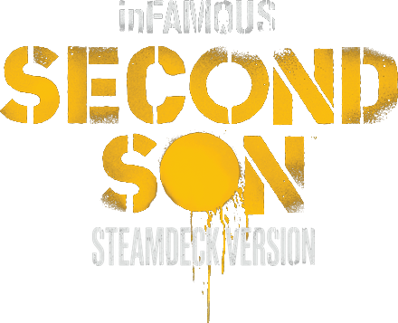</p>

<p align="center"><b>Português</b> • <a href="README.md">English</a></p>

# inFAMOUS Second Son: Steamdeck Version

Port nativo do inFAMOUS Second Son (PS4) para o Steam Deck, sem emulador. Ele roda a partir do
[iss_pc](https://github.com/HayatoG/iss_pc) de HayatoG (recompilação do jogo para PC, com o renderer v2), com o
trabalho específico do Deck descrito abaixo: desempenho, memória, controle, telas e um instalador que dispensa
teclado e mouse.

**Você precisa da sua própria cópia do jogo.** Este repositório não tem nenhum arquivo do jogo e nada do jogo é
baixado: o instalador só usa os `.pkg` que você já tem.

<p align="center">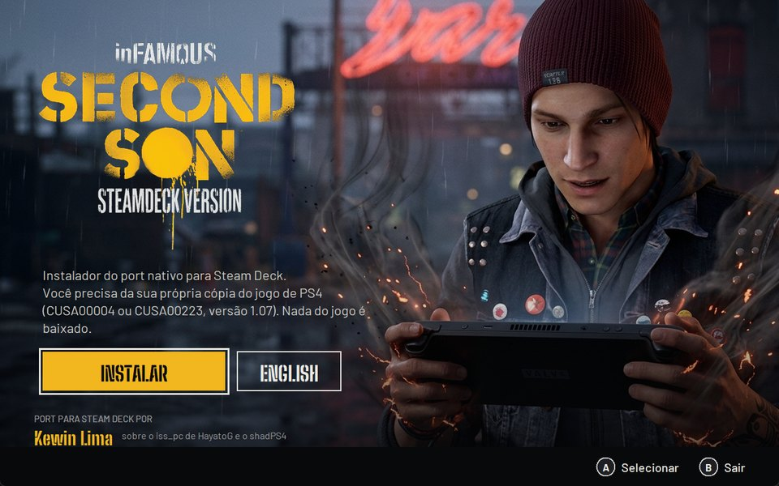</p>

## O que tem nesta versão

- Jogo jogável do começo ao fim: zerado no Deck com karma bom; o caminho do karma mau está sendo jogado agora.
- Renderer v2 com memória ajustada para os 16 GB do Deck: o jogo usa uns 3,5 GB de RAM em vez de 6, e o trecho mais
  pesado testado (a corrida de neon) foi de 33 para 41 FPS de média.
- Resolução 16:10 nativa da tela do Deck, com os vídeos cortados para 16:10.
- Giroscópio do Deck no minigame de grafite, botão Steam pausa o jogo (como o botão PS), menu do port no botão View.
- Telas de salvar e de carregamento no estilo do jogo, letras A/B do Deck.
- Cache de shaders: cada shader é compilado uma vez só e guardado.
- Pular vídeos (experimental, desligado de fábrica): no menu do port, aba Extras.
- Atualização automática: antes de abrir o jogo, o atalho confere se saiu versão nova e atualiza sozinho. Saves,
  shaders e opções nunca são apagados.

## Feito para o Steam Deck

Tudo o que mudou em relação ao jogo de PS4 para ele parecer um jogo de Steam Deck.

### Minigame do spray com o Deck

No PS4, o grafite se faz virando o controle de lado e chacoalhando, pelo sensor de movimento. No Deck isso funciona
com o giroscópio dele, e as instruções do jogo foram redesenhadas com o Steam Deck no lugar do controle do PS4: o
Delsin chacoalhando o Deck e as mãos virando o Deck de lado.

<p align="center">
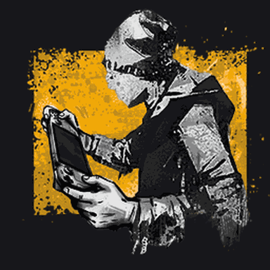

</p>
<p align="center">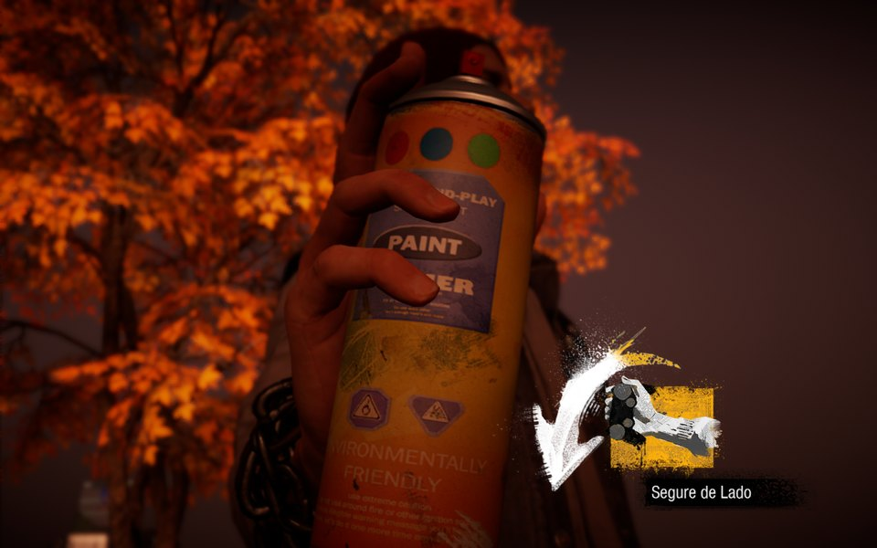</p>

Sem giroscópio (ou para quem prefere), o menu do port tem um guia de como fazer o grafite com os analógicos.

### Tela de controles com o Deck

Nas Opções do jogo, o desenho do controle do PS4 virou o Steam Deck, com os botões de trás (L4, L5, R4, R5) e o que
cada um faz.

| PS4 | Steam Deck |
|---|---|
| 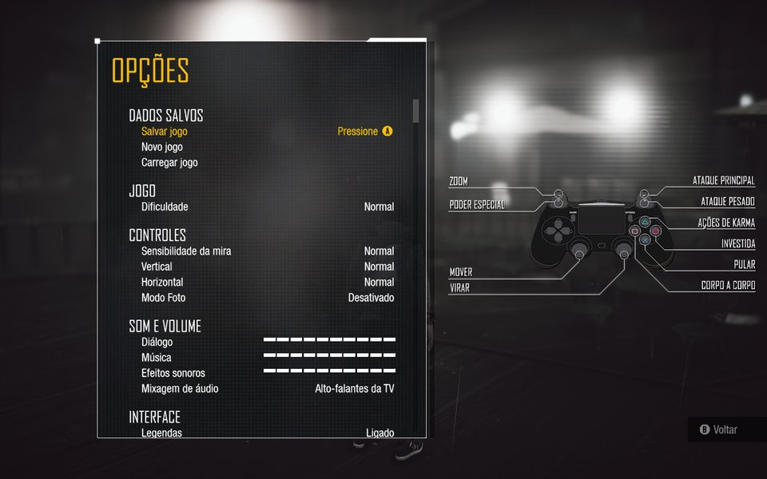 | 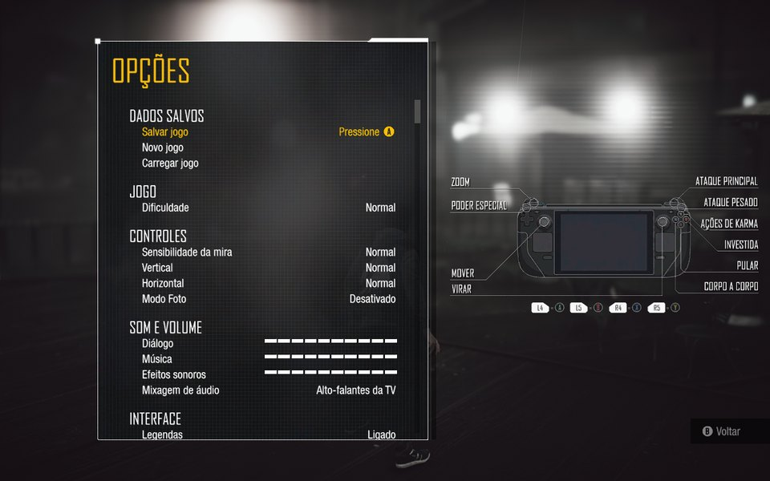 |

### Botões do Deck no jogo

Os ícones de botão do jogo (dicas, menus, tutoriais) trocados pelos do Deck: A, B, X, Y, MENU e PAD (os trackpads)
no lugar de cruz, círculo, quadrado, triângulo, Options e touchpad, no mesmo estilo dos ícones originais e com a
fonte do próprio jogo.

<p align="center"></p>

O instalador gera esses ícones no próprio Deck, a partir dos arquivos do seu jogo, nos 15 idiomas (uns 20 segundos;
nada do jogo vem no pacote). O gerador é Python puro, sem dependências: [deck/botoes_deck.py](deck/botoes_deck.py).

### Tela de abertura

Enquanto os shaders são preparados, uma tela no estilo do jogo, com a arte do Delsin com o Steam Deck, o logo
Steamdeck Version pintado como spray, a barra de progresso e o tempo restante.

<p align="center">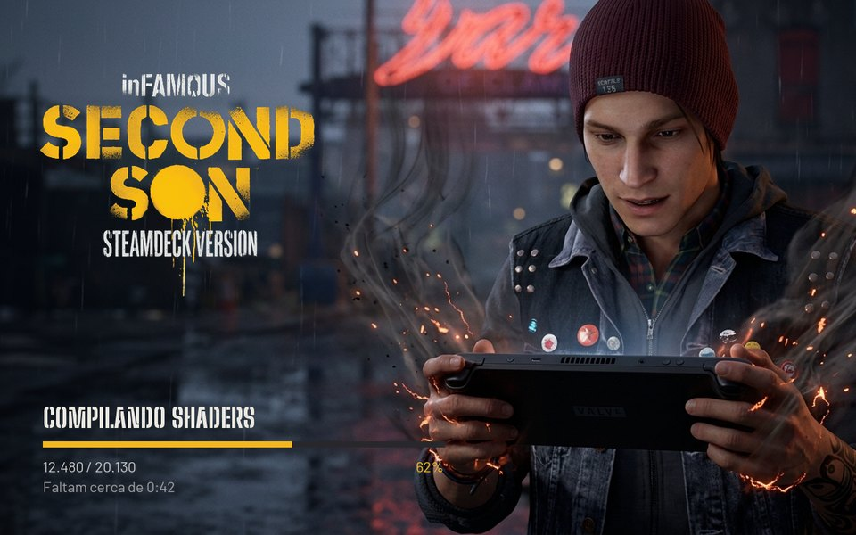</p>

### Pular vídeos (experimental)

Ligado em Extras no menu do port: durante um vídeo, segurar o botão de menu por 1 s pula a cena (um toque rápido
continua pausando). A tela fica coberta com a arte do Delsin até o jogo voltar, e o áudio da cena fica mudo.

<p align="center">
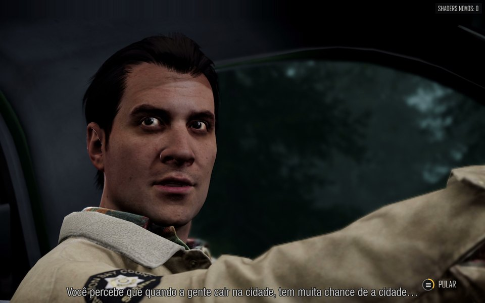
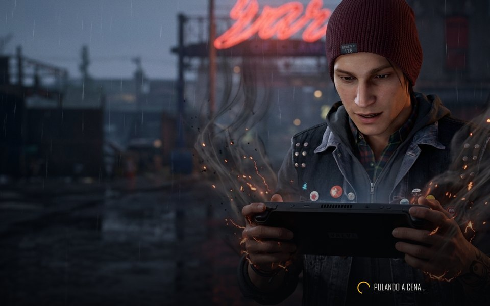
</p>

### Easter Eggs

Vem desligado. Ligue em Extras no menu do port e preste atenção nos muros que você pintar. Não vamos contar mais
nada: é surpresa.

### E mais

- **Giroscópio:** a Steam desliga o giroscópio do controle do Deck e entrega um controle virtual ao jogo; o port lê o
  controle do Deck direto e liga o giroscópio sozinho.
- **Trackpads:** o esquerdo e o direito viram as duas metades do touchpad do PS4 (clique firme = clique).
- **Botão Steam:** congela o jogo enquanto o menu da Steam ou o menu rápido estiver aberto, como o botão PS.
- **Menu do port no botão View**, com abas de gráficos, desempenho, controle e Extras, no estilo do jogo.
- **Telas de salvar e carregar** refeitas no estilo do jogo, com as letras A e B do Deck.
- **16:10:** a resolução da tela do Deck (1280x800) e os vídeos cortados para 16:10.
- **Artes da biblioteca da Steam:** capa, banner, fundo, logo e ícone do Steamdeck Version.

## Requisitos

- Steam Deck (testado no SteamOS 3.8).
- Os `.pkg` do seu jogo: o jogo base (24 GB) e a atualização 1.07 (3,9 GB).
  - **CUSA00004** (Europa): a versão testada no Deck, do começo ao fim.
  - **CUSA00223** (EUA): a versão principal do port original; o executável 1.07 é o mesmo.
- 32 GB livres no SSD ou no cartão microSD, além do espaço dos `.pkg`.
- Internet só para baixar o port (uns 110 MB).

## Instalação (sem teclado e sem mouse)

1. Copie os `.pkg` para o Deck: para a pasta **Downloads** ou para o **cartão microSD** (qualquer pasta). Pelo PC,
   dá para usar um pen drive, o cartão SD ou o Warpinator.
2. No Deck, segure o botão de ligar e escolha **Mudar para a Área de Trabalho** (Modo Desktop).
3. Abra o navegador, entre na página de [releases](https://github.com/KewinBR/infamous-second-son-steamdeck/releases/latest)
   e baixe o arquivo **`Instalar inFAMOUS.desktop`**.
4. Na pasta Downloads, toque duas vezes nele (se o sistema perguntar, escolha **Continuar/Executar**).
5. O instalador abre em tela cheia. Use o toque ou o controle (direcional, **A** confirma, **B** volta):
   1. **Onde está o jogo:** ele acha os `.pkg` sozinho e marca o jogo e a atualização.
   2. **Onde instalar:** SSD (carrega mais rápido) ou cartão microSD.
   3. **Instalando:** extrai o jogo e aplica a 1.07 (uns 20 minutos; deixe o Deck na tomada).
   4. **Pronto:** toque em **Voltar ao Modo de Jogo**. O jogo aparece na biblioteca da Steam com capa e ícone.

Prefere o Konsole? Uma linha faz o mesmo que os passos 3 e 4:

```bash
curl -L https://github.com/KewinBR/infamous-second-son-steamdeck/releases/latest/download/instalar.sh | bash
```

<p align="center">
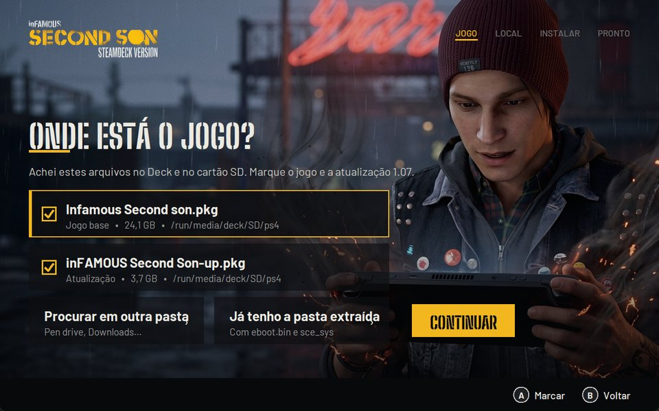
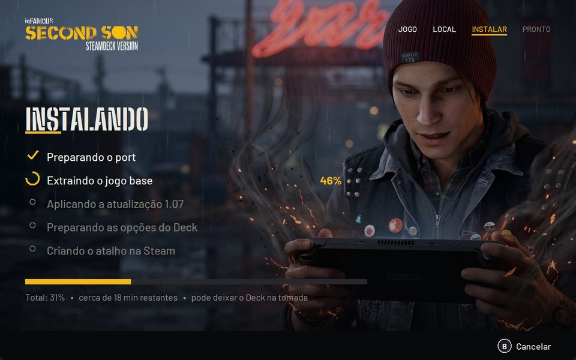
</p>

### Já tenho o jogo extraído

Na tela "Onde está o jogo", escolha **Já tenho a pasta extraída** e aponte a pasta que tem o `eboot.bin` e a pasta
`sce_sys` (o jogo base com a atualização 1.07 copiada por cima).

### Extrair os .pkg na mão (opcional)

O instalador faz isso sozinho. Se quiser extrair por conta própria, o pacote da release traz o `pkgx` (o extrator do
shadPS4 0.6.0 em linha de comando, sem dependências):

```bash
./bin/pkgx "Infamous Second son.pkg" ~/jogos/inFAMOUS
```

```bash
./bin/pkgx "inFAMOUS Second Son-up.pkg" ~/jogos/inFAMOUS
```

O primeiro extrai o jogo base; o segundo aplica a atualização 1.07 por cima, na mesma pasta. Depois, use a opção
**Já tenho a pasta extraída** no instalador.

## Jogando

- **Primeira abertura:** a tela de carregamento prepara os shaders (alguns minutos, uma vez só).
- **Menu do port:** botão **View** (o de dois quadradinhos, à esquerda da tela). Gráficos, desempenho, controle e a
  aba Extras.
- **Botão Steam:** pausa o jogo enquanto o menu da Steam estiver aberto.
- **Pular vídeos:** ligue em Extras > Pular vídeos (Experimental); durante um vídeo, segure o botão de menu por 1 s.

## Atualizações

O atalho da Steam passa por um iniciador que, antes de abrir o jogo, confere a última release deste repositório. Se
tiver versão nova, mostra a tela "Atualizando", baixa só o port e abre o jogo em seguida. Sem internet, o jogo abre
na versão instalada. Para desligar, mude `"atualizar": false` em `~/.config/infamous-ss-deck/config.json`.

## Desinstalar

Apague a pasta `infamous-ss-deck` (no SSD fica na sua pasta pessoal; no cartão, na raiz dele), a pasta
`~/.local/share/infamous-ss-deck` (saves e shaders: guarde a `user/savedata` se quiser os saves) e o atalho na
Steam.

## Problemas

- O registro de cada abertura fica em `~/.local/share/infamous-ss-deck/logs/ultimo.log`.
- O do instalador, em `~/.config/infamous-ss-deck/instalador.log`.
- Abra uma [issue](https://github.com/KewinBR/infamous-second-son-steamdeck/issues) com o registro e o que
  aconteceu.

## Créditos

**Port para Steam Deck:** Kewin Lima.

Este trabalho existe por causa destes projetos (todos GPL-2.0, como este):

- [iss_pc](https://github.com/HayatoG/iss_pc), de HayatoG (Guilherme): o port nativo do inFAMOUS Second Son para PC,
  incluindo o renderer v2 ([PR #402](https://github.com/HayatoG/iss_pc/pull/402)). A base de tudo aqui.
- As bases do iss_pc: [tlg_pc](https://github.com/HayatoG/tlg_pc) e [gr2_pc](https://github.com/HayatoG/gr2_pc)
  (HayatoG), [gow3_pc](https://github.com/FelipePrado0/gow3_pc) (FelipePrado0),
  [bloodborne_pc](https://github.com/deadinside28/bloodborne_pc) (deadinside28),
  [shadPS4](https://github.com/shadps4-emu/shadPS4) e o fork
  [shadPS4-Infamous-FixBuild](https://github.com/rayhlancaner-png/shadPS4-Infamous-FixBuild) (Eye Of The Ruins,
  TOXIC-KID, 0xDeftones), [ShadowOfTheColossus-PC](https://github.com/AjncSystem/ShadowOfTheColossus-PC) (AjncSystem,
  com partes do Pink-shadPS4 de luizgustavs).
- O extrator de `.pkg` (`pkgx`) é o código de extração do [shadPS4](https://github.com/shadps4-emu/shadPS4) 0.6.0
  num programa de linha de comando, com correções para arquivos grandes (fonte em [ferramentas/pkgx](ferramentas/pkgx)).
- Fontes do instalador: Big Shoulders Stencil (The Big Shoulders Project Authors) e Barlow (Jeremy Tribby), licença
  SIL OFL 1.1.
- Artes do Delsin com o Steam Deck e do Deck em neon: geradas no Google Flow para este projeto.

inFAMOUS e inFAMOUS Second Son são marcas da Sony Interactive Entertainment; o jogo é da Sucker Punch Productions.
Este é um projeto de fãs, sem relação com elas.

## O que aprendemos no caminho

O diário completo fica em [docs/aprendizados.md](docs/aprendizados.md). Os principais pontos:

- **Memória:** o renderer copiava 3,2 GB da memória da GPU do jogo para uma arena própria. Apontando a GPU direto
  para os dois heaps do jogo (heap unificado, com o tamanho exato: 64 KB a mais e o renderer recusa), a RAM do jogo
  caiu de 6 para 3,5 GB e a corrida de neon foi de 33 para 41 FPS.
- **Coletor de texturas:** medindo o uso total do Deck (que inclui a memória compartilhada), ele apagava texturas
  todo quadro. Medindo só as texturas, as travadas sumiram.
- **Onde vai o quadro:** o jogo espera a GPU esvaziar a fila a cada quadro. Esperar um quadro a menos deu uns 4 FPS
  a mais, mas o neon, a fumaça e as explosões sumiram: o jogo lê a simulação de partículas que a GPU calcula, e ela
  ainda não estava pronta. Descartado.
- **Shaders:** o jogo tem 10.374 shaders e 13 mil combinações de pipeline já vistas. Compilar tudo de antemão não
  funciona sem a lista de materiais do jogo; o cache guarda cada pipeline compilado e a abertura seguinte já os
  carrega.
- **Extração:** o PkgTool da LibOrbisPkg grava zeros em partes de alguns arquivos; o código do shadPS4 extrai certo.
- **Steam Deck:** a Steam reescreve o `shortcuts.vdf` enquanto está aberta (o instalador fecha a Steam, grava e
  deixa ela voltar); a Steam desliga o giroscópio do controle e entrega um controle virtual (o port lê o controle
  do Deck direto e liga o giroscópio); o núcleo físico 0 do Deck roda mais devagar que os outros (as threads
  críticas ficam fora dele).

## Licença

GPL-2.0, como o iss_pc ([LICENSE](LICENSE)). O código do port, com todas as mudanças feitas para o Deck, está em
[KewinBR/iss_pc-steamdeck](https://github.com/KewinBR/iss_pc-steamdeck) (ramo `steam-deck`). As fontes do instalador seguem a SIL OFL 1.1
(`instalador/fontes/`).
